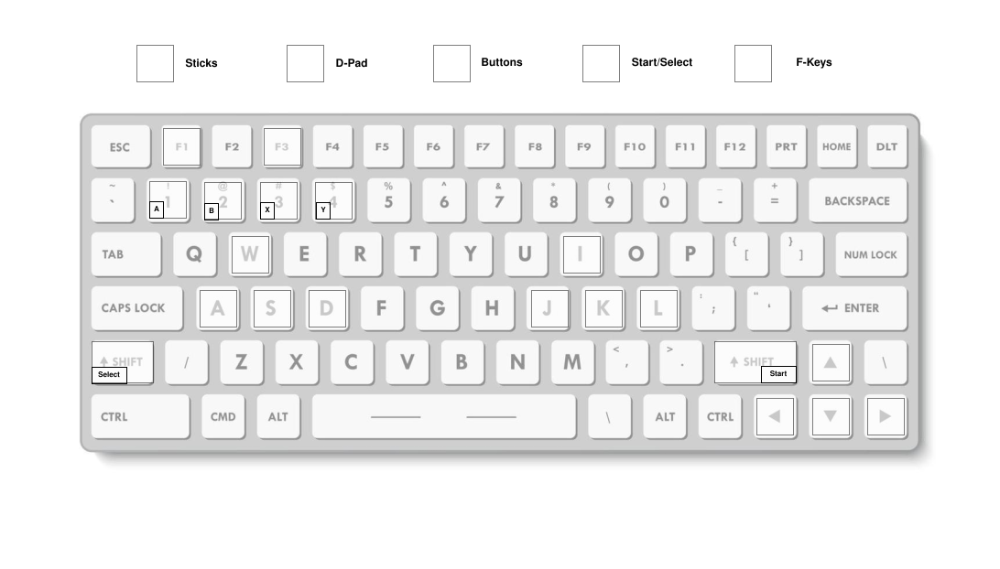

Simulation
==========

Run Isaac Sim by default, or select MuJoCo:

.. code-block:: bash

   make simulation
   make simulation SIM_TYPE=sim-mujoco

Use make control-sim for a detached development container plus Isaac Sim,
make control for the container alone, and make teleoperation for the full
teleoperation stack.

Input
-----

The Logitech F310 uses the Unitree remote layout and must be in XInput mode.
Keyboard controls are:

=================  =====================
Control            Keys
=================  =====================
Left stick          W/S and A/D
Right stick         I/K and J/L
A, B, X, Y          1, 2, 3, 4
L1, R1              E, U
L2, R2              Q, O
D-pad               Arrow keys
SELECT, START       Left/Right Shift
=================  =====================

The full mapping is shown below.

Isaac Sim modes
---------------

The default scene pins the pelvis and disables leg collisions for manipulation,
collection, and evaluation.

Enable walking mode with:

.. code-block:: bash

   make environment WALK=1

Walking mode enables foot contact and releases the pelvis. Enter READY, then
MOVE, and use the stick keys above. Press 9 in the Isaac window to release the
elastic band. The calibrated drilling task is not supported in walking mode.

Pass other simulator options through SIM_EXTRA_ARGS:

.. code-block:: bash

   make environment SIM_EXTRA_ARGS="--cfg.walk-mode --cfg.walk-reset-height 0.82"

Camera calibration
------------------

.. code-block:: bash

   make environment CALIBRATION=1
   ros2 run g1_sensors head_camera_calibration

Optional offsets:

.. code-block:: bash

   make environment CALIBRATION=1 \
     CALIBRATION_RPY="1.5 -3 2" \
     CALIBRATION_XYZ="0.012 -0.007 0.021"

Press s to collect a placement, t before moving the robot, and e to write
~/.ros/head_camera_extrinsics.yaml.

Isaac window keys
-----------------

=====  ====================================================
Key    Action
=====  ====================================================
R      Reset the robot and randomize targets
V      Next deterministic evaluation scenario
Z      Place the fixed demonstration wall
B      Release the pelvis pin
7/8    Lower or raise the elastic-band anchor
9      Toggle the elastic band
=====  ====================================================

Drill contact
-------------

The drill-bit collider is disabled by default. Enable it when contact must be
simulated:

.. code-block:: bash

   make environment DRILL_CONTACT=1
   make environment WALK=1 DRILL_CONTACT=1

This changes the loaded stage only; it does not modify the USD asset.
